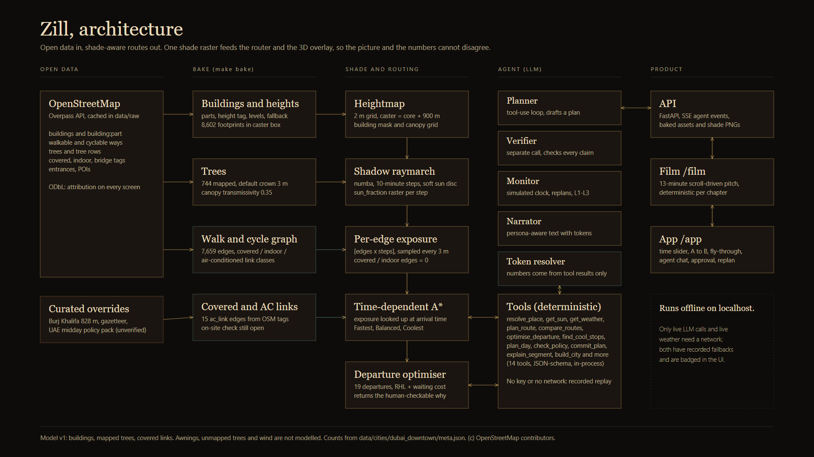

# Zill

*The AI agent that routes you through the shade.*

Zill builds a 3D model of a hot city from open data (OpenStreetMap), computes where the sun's shadows fall at every ten minutes of the day, and routes people through shade and air-conditioned links. An agent compares Fastest, Balanced and Coolest routes, searches departure times, checks its own claims, and replans when things change. The hero city is Downtown Dubai.

Three surfaces on one engine: the cinematic pitch film at `/film`, the live app at `/app`, and a hotel concierge widget at `/embed/hotel`. Everything runs on `localhost` without internet; only a live LLM call and live weather need a network, and both have recorded fallbacks.

Honest limits: shade comes from buildings, mapped trees and covered links only (awnings, unmapped trees and wind are not modelled), most building heights are defaults, and the air-conditioned link is not yet verified on site. Details in [`docs/VALIDATION.md`](docs/VALIDATION.md).



## Prerequisites

- Python 3.11, provided through [uv](https://docs.astral.sh/uv/) (`uv venv --python 3.11` is run for you)
- Node 20 or newer, with npm
- GNU make is optional. Every make target is a thin wrapper around `python scripts/zill.py <target>`.

## Run it

```
make setup     # first time: venv, backend, npm ci, Playwright Chromium
make demo      # production build, FastAPI :8000 + Next :3000
```

Wait for `Zill ready`, then open http://localhost:3000/health (pre-flight), http://localhost:3000/film and http://localhost:3000/app. Without make: `python scripts/zill.py setup`, then `python scripts/zill.py demo`. The baked Downtown Dubai data is committed, so no bake is needed.

| Goal | make | Without make |
| --- | --- | --- |
| Install everything | `make setup` | `python scripts/zill.py setup` |
| Dev servers with reload | `make dev` | `python scripts/zill.py dev` |
| Production build and serve | `make demo` | `python scripts/zill.py demo` |
| Run all tests | `make test` | `python scripts/zill.py test` |
| Bake a city from OpenStreetMap | `make bake` | `python scripts/zill.py bake` |
| Lint | `make lint` | `python scripts/zill.py lint` |
| Backup videos + deck stills | `make record` | `python scripts/zill.py record` |
| Deck stills + architecture PNG only | | `python scripts/zill.py deck` |
| Clean-clone test (PASS/FAIL) | | `python scripts/zill.py freshclone` |

Film keys: `Space` play/pause, `[` `]` speed, arrows and `1`-`9` `0` `-` `=` chapters, `F` fullscreen, `H` hide chrome, `A` open the app. Full list in [`docs/RUNBOOK_DEMO.md`](docs/RUNBOOK_DEMO.md).

## Configuration

Copy `.env.example` to `.env` and add `ZILL_LLM_API_KEY` (OpenAI-compatible endpoint). Without a key the agent runs in recorded/scripted replay mode and says so on screen. Never commit `.env`.

## Repository layout

```
backend/zill/     config, geo, data bake, sun, shade, routing, weather, agent, api
backend/replay/   recorded agent sessions (scripted until a key is added)
backend/tests/    pytest suite (222 tests)
data/cities/      baked Downtown Dubai (buildings, graph, shade rasters, exposure)
data/scenarios/   hero.json (journeys found by search, not hand-picked)
data/curated/     landmark overrides, gazetteer, policy pack (unverified)
data/weather_cache/  recorded Open-Meteo files
frontend/src/     three (scene), film (/film), app-ui (/app), state, lib
frontend/scripts/ QA capture, record-film, record-app, export-deck-assets, render-svg
scripts/zill.py   task runner (stdlib only)
docs/             documentation (below); docs/deck_assets for slides and backup video
```

## Documentation

| Document | What it is |
| --- | --- |
| [`PRD.md`](PRD.md) | product spec |
| [`docs/ARCHITECTURE.md`](docs/ARCHITECTURE.md) | components, data flow, algorithms, performance, diagram |
| [`docs/VALIDATION.md`](docs/VALIDATION.md) | data quality, tests, hero results, limits, field-test plan |
| [`docs/RUNBOOK_DEMO.md`](docs/RUNBOOK_DEMO.md) | pre-flight checklist, start commands, failure playbook |
| [`docs/SPEAKER_NOTES.md`](docs/SPEAKER_NOTES.md) | talking points per chapter, managerial story, judge Q&A |
| [`docs/PITCH_STORYBOARD.md`](docs/PITCH_STORYBOARD.md) | chapter-by-chapter storyboard |
| [`docs/OPEN_ITEMS.md`](docs/OPEN_ITEMS.md) | everything humans must verify, fill in or decide |
| [`docs/CONTRACTS.md`](docs/CONTRACTS.md) | binding data and API formats |
| [`docs/DECISIONS.md`](docs/DECISIONS.md), [`docs/PROGRESS.md`](docs/PROGRESS.md) | decision log and build log |

Map data: &copy; OpenStreetMap contributors (ODbL).
