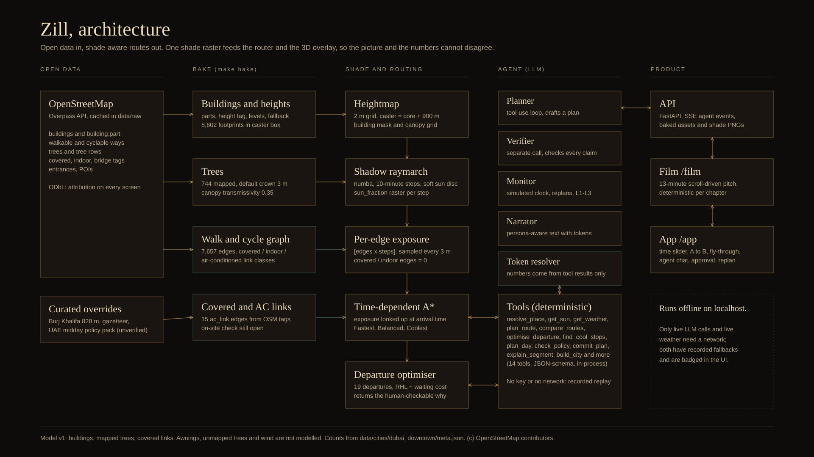

# ARCHITECTURE

Zill is a monorepo with three user-facing surfaces (the Film at `/film`, the App at `/app`, the embeddable hotel widget at `/embed/hotel`) on top of one Python engine. There is no database: baked files plus in-memory caches. Everything runs on `localhost` with no internet; only live LLM calls and live weather use the network, and both have recorded fallbacks.

Diagram files: `docs/deck_assets/architecture.svg` (source, brand palette, no gradients) and `docs/deck_assets/architecture.png` (1920x1080, ready for the deck). Regenerate the PNG with `cd frontend && npx tsx scripts/render-svg.ts ../docs/deck_assets/architecture.svg ../docs/deck_assets/architecture.png` (it is also done by `python scripts/zill.py deck` and `record`).

## 1. Data flow in one paragraph

OpenStreetMap (Overpass) is baked once into buildings, trees, a walk/cycle graph and covered/air-conditioned link classes (`backend/zill/data/`, `make bake`). Buildings and trees are rasterised into a 2 m height grid; a numba ray-march casts shadows toward the sun for every 10-minute step of four preset dates (`backend/zill/shade/`). The resulting `sun_fraction` raster is sampled along every graph edge to give an `[edges x steps]` exposure table. The router (time-dependent A*, `backend/zill/routing/`) looks exposure up at the traveller's arrival time and returns Fastest, Balanced and Coolest routes plus a departure-time table. An LLM agent (`backend/zill/agent/`) calls those same functions as tools, a verifier checks its draft, and every number in the final text is a `{{token}}` resolved from tool output. FastAPI serves it all (REST + SSE) and the Next.js frontend renders the Film and App from the same baked raster the router used, so the picture and the numbers cannot disagree.

## 2. Components

| Layer | Path | What it does |
| --- | --- | --- |
| Config and geometry | `backend/zill/config.py`, `geo.py`, `brand.py` | One source of constants; local metric frame (origin 25.1972 N, 55.2744 E; x east, y up, z south). Mirrored in `frontend/src/lib/geo.ts`. |
| Data bake | `backend/zill/data/` | Overpass fetch with cache, height rules, graph, covered/indoor/ac_link classification, POIs, GLB export. Output in `data/cities/<city_id>/`. |
| Sun | `backend/zill/sun/position.py` | pvlib solar position, Asia/Dubai; golden values in `data/curated/sun_golden.json`. |
| Shade | `backend/zill/shade/` | `heightmap.py` (2 m grid), `raymarch.py` (numba), `exposure.py` (per-edge), `cache.py`, `bake.py`, `explain.py` (which building shades a cell). |
| Routing | `backend/zill/routing/` | `graph.py` (CSR), `suntable.py`, `tdsp.py` (A*), `heat.py` (RHL), `departure.py`, `planner.py`, `scenarios.py` (hero search). |
| Weather | `backend/zill/weather/` | Open-Meteo live, then cache, then recorded files in `data/weather_cache/`. |
| Agent | `backend/zill/agent/` | `orchestrator.py` (Planner, Verifier, Narrator), `monitor.py`, `tools.py` (14 tools), `tokens.py`, `policy.py`, `replay.py`, `llm.py`. |
| API | `backend/zill/api/` | FastAPI app, request ids, typed errors, SSE. OpenAPI at `/docs`. |
| Scene | `frontend/src/three/` | One persistent R3F canvas shared by Film and App: buildings, shade ground, sky, routes, rigs, post. |
| Film | `frontend/src/film/` | `master.ts` timeline (12 chapters, 780 s), pure per-chapter functions. |
| App | `frontend/src/app-ui/` | Command bar, journey panel, time bar, agent panel, activity feed. |
| Ops | `scripts/zill.py`, `frontend/scripts/record-*.ts`, `export-deck-assets.ts` | Setup, demo, tests, recording, deck assets, clean-clone test. |

Ports: FastAPI `:8000`, Next `:3000`; Next proxies `/api/*` to FastAPI (`frontend/next.config.ts`).

## 3. File formats

The binding formats are in [`CONTRACTS.md`](CONTRACTS.md): `meta.json`, `buildings.json`, `buildings.glb`, `trees.json`, `graph.json` (columnar; edge index is the edge id everywhere), `links.geojson`, `pois.json`, `shade/<date_id>/index.json` + `step_HHMM.png` (8-bit, 0 = shade, 255 = sun, row 0 = north), `exposure_<date_id>.npz` (`float16 [n_edges, n_steps]`), the route JSON (section 5), `hero.json` (section 6) and the agent SSE/replay formats (section 7).

Grid convention (both Python and TypeScript): `[rows, cols]`, row 0 = north edge, col 0 = west edge, 2 m cells. Core grid 1,483 x 1,612 and caster grid 2,283 x 2,412 (`data/cities/dubai_downtown/meta.json`).

## 4. Key algorithms

**Sun.** `pvlib.solarposition` with apparent elevation; the unit vector toward the sun is `(sin az cos alt, sin alt, -cos az cos alt)` in the local frame. Below 2 degrees altitude every outdoor cell is treated as having no direct sun. Frontend `suncalc` agrees with the pvlib goldens within 0.5 degrees (`frontend/src/lib/sun.test.ts`).

**Shadow ray-march** (`shade/raymarch.py`). For each core cell a ray marches toward the sun in 2 m steps up to 1,500 m; the cell is shaded if a building top exceeds the ray height (pedestrian height 1.5 m). Two-level max-filtered height grids let rays skip 6 or 40 cells when they are above everything nearby (exact, see `docs/DECISIONS.md`). Soft edges come from five sun-disc samples (centre plus four rim points at 0.265 degrees) with sub-cell origin offsets, not a blur, so 90-degree rotation symmetry stays exact. Trees attenuate once per distinct tree crossed (transmissivity 0.35).

**Per-edge exposure** (`shade/exposure.py`). Sample every 3 m along each edge, bilinear-read `sun_fraction`, average. `covered`, `indoor`, `ac_link` edges are 0 regardless of the raster. Samples inside footprints that are not tagged indoor are snapped to the nearest outdoor value within 3 m (counts in `data/cities/dubai_downtown/shade/bake_log.json`: 112,212 samples, 1,389 in a building, 166 snapped, 1,223 left shaded).

**Time-dependent A*** (`routing/tdsp.py`). Edge cost `t_e (1 + lambda w_m sun_e(tau) uv(tau)) comfort_e`, where `tau` is the arrival time at the edge start (linear interpolation between 10-minute steps), `uv = clip(sin(alt)^0.6, 0.15, 1)` (a heuristic, documented as such), `lambda` = 0 / 1 / 3 for Fastest / Balanced / Coolest. Cost never drops below travel time, so the Euclidean heuristic stays admissible and FIFO holds. Speeds walk 1.4, cycle 4.5, scooter 5.0 m/s; crossing waits 8 s / 10 s; stairs halve walking speed and are forbidden for wheels (`config.py`). "Coolest" is the lowest-RHL route among lambda 3, lambda 1 and Fastest whose sun exposure is no higher than Fastest's, and the stats say so when lambda 3 is not that route.

**Relative Heat Load** (`routing/heat.py`). `RHL = sum t_e (sun_e + 0.35 (1 - sun_e))` over outdoor edges plus `0.1 t_e` over indoor/AC edges. It is a model index, not a measurement, and is labelled that way in the UI.

**Departure optimiser** (`routing/departure.py`). Evaluates the Balanced route for each 5-minute departure in a window, scores `rhl + 0.25 * wait_s`, honours an optional latest arrival, and returns a `why` struct listing segments whose shade state changes. It is allowed to answer "leave now": for the hero trip it does (see VALIDATION).

**Hero search** (`routing/scenarios.py`). Searches POI pairs instead of hand-picking them: 38 places, 1,028 pairs 400-1,500 m apart, 4 departures, 2 dates, walk and cycle = 10,408 routed jobs, rejection reasons counted in `data/scenarios/hero.json["search"]`.

**Agent.** Planner (tool-use loop, at most 12 tool calls per turn, 8 s per tool) drafts a JSON plan with `{{tokens}}`; the deterministic verifier checks tokens, bare numbers, edge validity for the mode, arrival window, policy pack and qualitative claims against stats; an LLM verifier pass runs only when a live model is connected; up to 2 fix rounds. The resolver prints units (`_min`, `_pct`, `_time`, `_m`) and any digit not from a token or the user's own message is rejected (`tokens.py`, 240-case fuzz test). The monitor runs on a simulated clock and applies the autonomy policy: L1 advise only, L2 ask before committing, L3 auto-apply replans within +/-10 min arrival and +10 % RHL, with undo.

**Replay.** `backend/replay/*.json` are recorded sessions (`scripts/record_replay.py`). With no key, no network or `ZILL_REPLAY=1` the API replays the closest recording and the UI badge says "Recorded session" (live model) or "Scripted session" (generated by the scripted planner). All four shipped recordings currently have `live: false` (see OPEN_ITEMS).

**Film determinism.** Every chapter is a pure function of chapter-local `t`; one frame loop maps scroll or autoplay to `evaluate(t)` (`frontend/src/film/master.ts`, `scroll.ts`). QA hooks: `/film?qa=1&t=<seconds>` seeks and sets `window.__zillFrameReady`; `&rate=<x>` speeds autoplay for tests.

## 5. API surface

`/api/health`, `/api/config`, `/api/cities`, `/api/cities/{id}/meta`, `/api/cities/{id}/files/{path}`, `POST /api/cities/build` (SSE; replays the recorded build log and labels it cached), `/api/sun`, `/api/shade/{city}/{date}/{HHMM}.png`, `POST /api/shade/compute`, `POST /api/route`, `POST /api/departure`, `POST /api/plan`, `/api/weather`, `/api/gazetteer/{city}`, `/api/scenarios/{city}`, and the agent endpoints `POST /api/agent/session|message|approve|simulate`, `GET /api/agent/replays|status` (routers in `backend/zill/api/routes_*.py`).

## 6. Performance

All figures are measured on the development laptop (24 logical cores, RTX 4070 Laptop GPU) with other work running at the same time, so treat them as upper-ish bounds. Full table and commands are in [`VALIDATION.md`](VALIDATION.md).

| What | Number | Source |
| --- | --- | --- |
| Shade ray-march, one 10-min step, 1,483 x 1,612 core grid | mean 0.53-0.62 s per step, max 0.82 s (kernel); PROGRESS records mean 0.72 s / max 1.08 s with the shade stream's own bench | `data/cities/dubai_downtown/shade/bake_log.json`, `docs/PROGRESS.md` |
| Full bake of 4 preset dates (311 steps) | 230.8 s including PNG writes | `shade/bake_log.json` (`total_s`) |
| Single route (lambda 3), 100 random pairs | p50 7.6 ms, p95 25.1 ms, max 39.2 ms | `docs/qa/phase9/bench_routing.json` |
| Route triple (`compare`) | p50 21.2 ms, p95 68.8 ms | same |
| Departure table, 19 departures | 38.3 ms | same |
| Scene frame time, 1080p, high tier | mean 8.8 ms, p95 12.2 ms, about 160 draw calls | `docs/qa/phase6/perf.json` |

PRD gates were: step at most 2.5 s, route under 300 ms, departure table at most 3 s. All met with wide margin.

## 7. What is deliberately not here

Accounts, payments, push notifications, real-time traffic, ML training, trees beyond what OSM maps (PRD 3.3). A "send to phone" control, if present, is a labelled mock.
